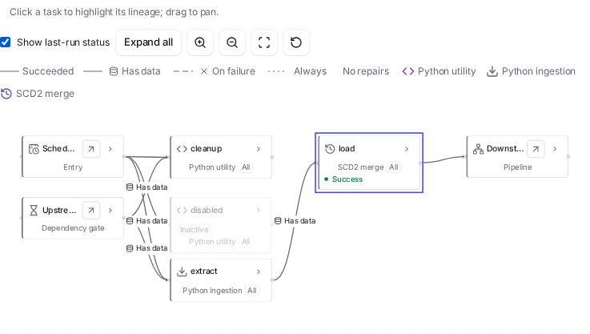
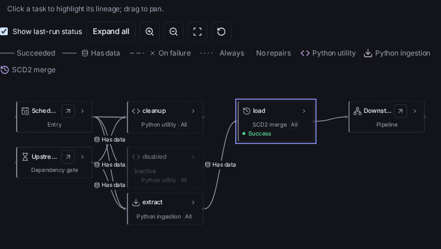
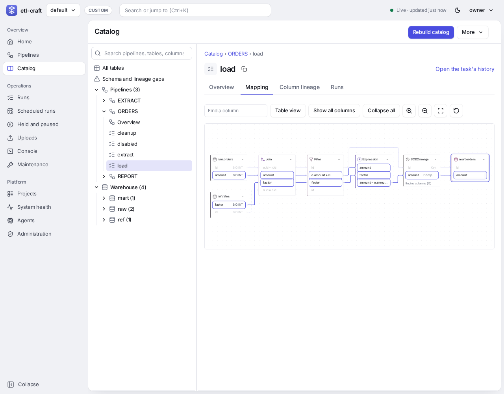
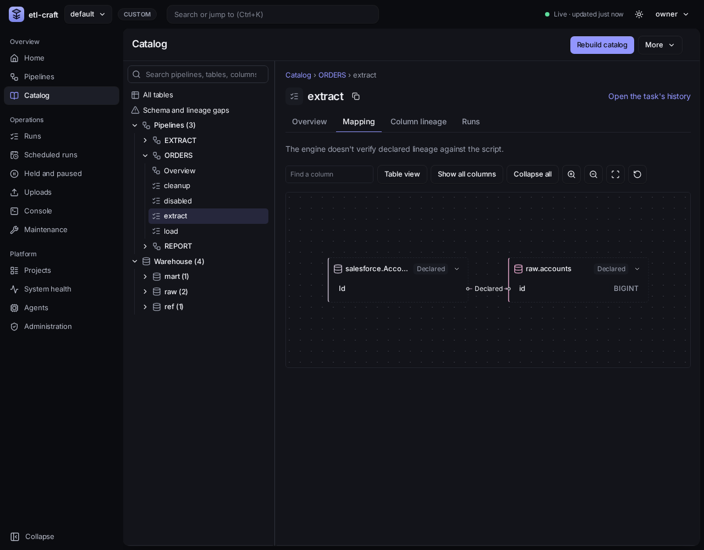
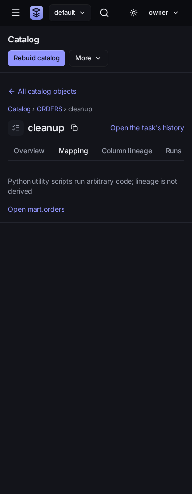
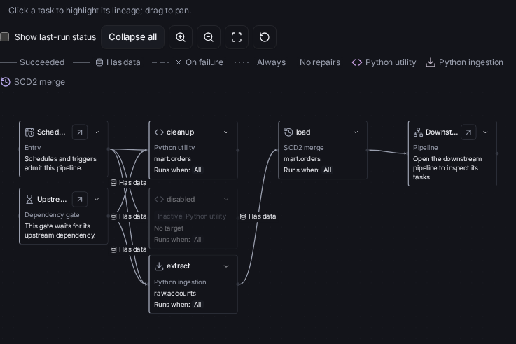

# The catalog site

The generated catalog contains the whole project. Pipeline permission groups do not filter this
static site; restrict its hosting access. The API and live UI apply grants.

`etl-craft generate-docs` writes a searchable catalog of everything etl-craft runs: every
pipeline, task, table, business rule and Python script, with lineage graphs that follow each
table and column from its first sources to its last consumers, across tasks and pipelines.

```bash
etl-craft generate-docs                      # into catalog/ in the project directory
etl-craft generate-docs --output /srv/docs   # anywhere else
etl-craft generate-docs --with-warehouse     # compare documented and deployed schemas, add types and comments
etl-craft generate-docs --strict             # write nothing if any SQL task cannot be traced
```

The site is plain files, with nothing loaded from elsewhere: open `catalog/index.html` from disk,
serve the folder from any web server, or publish it with `publish-docs`. Pages ask search engines
not to index them.

## The catalog in the app

The UI's **Catalog** page is a data explorer over the same build: a resizable tree on the left (the
project's pipelines with their tasks, and the warehouse's schemas with their tables) with a search that
also finds columns, and on the right the selected object under a breadcrumb.

- A **table** has Overview (a description from the tasks that write it, its columns with a filter, and an
  *About this table* column), Data (the first 100 rows, for developers; see [the browser
  UI](browser-ui.md#previewing-a-tables-rows)), Lineage (the tables upstream and downstream, to a depth you
  choose), Column lineage (the columns each column is made from), History (the recent writes) and Quality
  (its business rules and its schema and lineage gaps).
- A **pipeline** has Overview (description, tasks with what they read and write, schedule, SLA, tags),
  a task graph and its recent runs, with a link to the pipeline workspace.
- A **task** has its documentation, reads and writes, column lineage and recent runs.
- **Schema and lineage gaps** lists every gap with a state filter.

The page reads `catalog.json`, which `generate-docs` writes beside the HTML pages from the same
build, so the two never disagree. It shows the last build: use **Rebuild catalog** after metadata
changes. The static site above is what `publish-docs` publishes.

## What is in it

Four tabs at the top of every page, and a trail of links back up from wherever you are:

| Tab | Leads to |
|---|---|
| **Search** | counts, and search across everything |
| **DAGs** | every pipeline with its name, description, schedule, the pipelines it depends on, its last run, how many of its recent runs succeeded and how long they took on average; the Python scripts; and the SQL tasks whose columns cannot be traced |
| **Schema and lineage gaps** | project-wide outcome counts, searchable gap records, check time, input version and links to affected tables and tasks |
| **Warehouse** | every database, then schema, then table, with the tasks that write and read each table, its pipelines and business rules; and the external sources Python scripts read |

Every task, table, pipeline, rule and script a page mentions is a link to its own page, so any
chain can be followed: DAGs › pipeline › task › the table it writes › the task that reads that
table › its pipeline, and so on.

| Page | Shows |
|---|---|
| Pipeline | its description (`CFG_PIPELINES.DESCRIPTION`), schedule, SLA, refresh type, last run, whether it is paused, the pipelines it depends on and that depend on it, its **DAG**, its tasks with what each waits for, writes and reads, and its **runs** |
| Run | one run of a pipeline: its status, run date (and whether it was a backfill), when it ran and how long it took, its SLA, each task's status, attempts, counts and message, what operators changed in it, the upstream runs it was **built from**, and the downstream runs that **used** it |
| Task | its pipeline, the tasks it waits for and that wait for it (with the dependency type), handler, the tables it reads, writes and checks, its business rules, documentation and documentation version, column mapping, parameters with the SELECT (a `SCRIPT_FILE` is shown too), its last run with its counts and error, and its **runs** |
| Table | the tasks that write and read it, their pipelines, its business rules, its last write and row counts, its columns with where each is made from, and its lineage graph |
| Business rule | type, table, key column, wave, task, and its condition |
| Python script | whether the file is there, the tasks that run it, and what they read and write |

## Runs and KPIs

A pipeline's page ends with its latest 30 runs:

- **KPIs**, in separate groups for scheduled, backfill, repair and other runs: how many of
  the finished runs succeeded, how many failed or were cancelled, SLA misses, and the average
  and longest run. A `SKIPPED` run did no work and one still
  `IN-PROGRESS` has not ended, so neither counts either way.
- **A bar per run**, oldest first: its height is how long the run took, its colour the run's
  status. Each bar opens that run's page.
- **A row per run**: its run date, status, start, duration, SLA, the upstream runs it was built
  from, and how many changes operators made to it.

A repaired logical run (`OUTPUT_REVISION > 1` or `REPAIR_PENDING = Y`) belongs to **Repair**;
otherwise a backfill belongs to **Backfill**, a schedule-triggered run to **Scheduled**, and
manual/orchestrator/stand-in runs to **Other**. Each logical run is counted once in its current
group, rather than counting repair attempts as extra runs. Task summaries inherit their
pipeline run's group. The DAG overview uses the same groups.

A task's page does the same for the task: the share of its runs that succeeded, the average run
and the average rows written, a bar per run of the rows it wrote, and a row per run with its
attempts, counts and message.

Each run has a page of its own, so runs chain like everything else: a run page lists the
upstream runs it was built from and the downstream runs that used it, from the
[consumption log](dependencies.md#dependencies-on-other-pipelines), each a link to that run's
page when that run is also in its pipeline's displayed history. Older referenced runs retain
their identity as text. Only consumption touching at least one displayed run is loaded;
older-to-older history is omitted. Each task also shows its latest 30 runs.

## A pipeline's DAG

Each pipeline page draws its tasks left to right, each after the tasks it waits for. Tasks of
other pipelines it waits for sit on the left. Lines show the dependency type:
`SUCCESS` solid without a badge, `HAS_DATA` solid with a database icon and “has data”,
`FAILURE` dashed with an X icon and “on failure”, and `ALWAYS` dotted with “always”.
All dependency edges use the neutral edge colour in both themes; colour is reserved for run
status. A “no repairs” marker means `CONSUME_REPAIRS=N`. Each type has a legend entry and
hovering an edge explains its condition in a sentence. Each task box lists the table it
writes (→), the tables it reads (←) and the tables its business rules check (✓); click a task or
a table to open it. The DAG pans and zooms like the lineage graphs.

A table is every SQL task's `TARGET_OBJECT`, every table a SELECT reads (joins and filters
included), every business rule's target reference, and every Python script's `TARGET_OBJECT`.
Tables are named as [lineage](lineage.md) names them: lower case, without the active warehouse
database.

## Lineage graphs

Each table page draws its lineage: the tables it is made from to the left, as far as they go, and
the tables made from it to the right. Arrows point from each source to what is made from it.

Tables open collapsed, showing their names; the page's own table opens with its columns. Click a
table's name to show or hide its columns (the columns lineage connects), or ↗ to open its page.
*Expand all* and *Collapse all* do every table at once.

| Line | Means |
|---|---|
| solid | the column is copied as it is |
| dashed | the column is derived: an expression, `CASE` or aggregate; the tooltip shows it, and a column may have several sources |
| dotted, box to box | the tables are linked, but not column by column: a Python script, or a task whose columns cannot be traced |

A column marked `ƒ` is made from no source column, such as `COUNT(*)` or a constant.

- **Click a column** to trace it: every path into it and out of it lights up, across every
  table shown, and each table on the way opens. Click it again, or *Clear trace*, to stop. A column's name in the table above the
  graph traces it too, and the link can be shared: `…/sales.orders.html#col=amount_usd`.
- **Pan and zoom:** drag the background to move around, or use the scroll bars. −, + and *Fit*
  zoom out, in, and to the whole graph; Ctrl or ⌘ with the mouse wheel zooms around the
  pointer. The frame grows with the graph, up to most of the window's height.
- **Direction** shows only what is upstream or downstream.
- **Depth** shows fewer levels. A deep graph opens three levels each way.

A graph draws at most 200 tables. Past that it stops at the last level that fits and says so;
`etl-craft lineage --table` follows every level.

## Search

The box at the top of every page searches as you type: pipelines, tasks, tables, columns, rules,
scripts, and descriptions and documentation. Names count most, then the start of a word, then
descriptions; letters in order also match, so `slsord` finds `sales.orders`. Enter opens every
result on the home page, where they can be filtered by kind.

## SQL that cannot be traced

A SQL task whose columns cannot be traced, such as `SELECT *` over a table whose columns are not
known, keeps its table on the graph, linked box to box from the tables its SELECT reads. The task
page shows *column lineage unavailable* with the reason, the home page lists every such task, and
`generate-docs` prints them. With `--strict` it writes nothing and exits 1 while any remain.

## Python scripts

A script's code is not read, so a `PYTHON` task says what it moves in two optional parameters:

| Parameter | Value |
|---|---|
| `TARGET_OBJECT` | derived from the task's active table reference, configured through the target components in `tasks.csv` |
| `LINEAGE_SOURCE` | declared external source as `system.object`, for example `salesforce.Account` or `s3.orders/*.csv` |
| `LINEAGE_COLUMNS` | optional `source_column:target_column` pipe-separated pairs; targets must be active declared columns |

The source appears on the graph as an external box, linked to the table.

## Column types and comments

With `--with-warehouse`, each table that exists in the warehouse gets its columns in the
warehouse's order, with their types, and their comments where the warehouse's
`information_schema` has them (DuckDB, Snowflake, Databricks). A table the warehouse cannot
describe keeps the columns lineage found, and the command logs why.

## Keeping it up to date

The site is plain files, so its run details, statuses, row counts, errors and last runs, are as
of when it was generated. Write it again on a schedule, nightly say, to keep them fresh; every
page says when it was generated and warns once its run details are more than a day old.

```yaml
Docs_site:
  prod:
    Schedule: "0 2 * * *"      # 02:00 every day: five cron fields, or @daily, @hourly, ...
    Output: /srv/etl-craft-docs  # optional: the folder generate-docs writes; default catalog/
```

Run `etl-craft controller` with a SERVICE account. The leader builds the catalog on
`Docs_site.Schedule` in the project's timezone, using the configured output folder or
`catalog/`. Without a schedule, only explicit `generate-docs` calls build the site.

Only one scheduled build runs at a time. It runs in a background thread so task leases and
pipeline dispatch continue. The controller waits for an admitted build before releasing
leadership at shutdown. Builds use metadata and local source files, without warehouse access;
use `generate-docs --with-warehouse` explicitly for a deployed-schema comparison.

The latest `generate-docs` request in `AUD_ACTIONS` is the restart cursor, including manual
requests. Missed ticks are not replayed, and ticks reached during a build are skipped. On a
first start without a recorded request, the first build is at the next tick. A failed build
is logged with its output folder and retried at the next tick. Each build records a
`REQUESTED` audit row followed by an immutable `SUCCESS` or `FAILURE` completion row with its
exit code, under the requesting account. A failure does not stop the controller.

Manual generation remains available:

```bash
etl-craft generate-docs
```

## Publishing the site

`etl-craft publish-docs` serves the site until it is stopped (Ctrl-C, or SIGTERM from a service
manager), so it can run as a long-lived service beside the nightly rebuild. It serves the folder
as it is at each request, so a rebuilt site is served as soon as it is swapped in.

**At a link, through ngrok.** Install the SDK on the machine that publishes
(`pip install 'etl-craft[publish]'`), put your ngrok authtoken in a variable, and name it:

```yaml
Docs_site:
  prod:
    Authtoken: NGROK_AUTHTOKEN         # the variable holding the token, never the token itself
    Domain: etl-docs.example.com       # optional: a domain reserved in your ngrok account
    Allowed_ips: [203.0.113.0/24]      # optional: only visitors from these ranges are served
```

```text
$ etl-craft publish-docs
publish-docs: serving /srv/etl-craft/catalog at https://etl-docs.example.com (Ctrl-C to stop)
```

- **Who can see it.** There is no login: anyone with the link can read the site, so share it
  like a document. The site is never listed or indexed: every response carries
  `X-Robots-Tag: noindex`, `robots.txt` disallows everything, pages send no referrer and cannot be
  framed, and folders are never listed. `Allowed_ips` limits it to your offices or VPN: every
  other visitor gets `403`. `publish-docs` enforces it itself, on any ngrok plan, from the
  visitor's address ngrok forwards. Teams behind a firewall allow the site's domain (the one
  `publish-docs` prints) through it.
- **A link that stays the same.** Without `Domain`, ngrok gives the account's own free domain.
  The URL is recorded in the Engine DB; if a later publish gets another one, links already
  shared would break, so `publish-docs` stops and names both. Set `Domain` to keep the first,
  or pass `--accept-new-url` to use the new one from then on.
- For the first few seconds after `publish-docs` starts, the link can show ngrok's own
  "endpoint is offline" page while ngrok routes to it; reload and the site appears.
- On ngrok's free plan, a browser first shows ngrok's own warning page once per visitor;
  a paid plan's domain does not.
- The variable only needs to be set on the machine that publishes; `doctor` says when it is
  missing there, and when the SDK is not installed.

**On this machine or network only**, without ngrok:

```bash
etl-craft publish-docs --local-only                         # http://127.0.0.1:<port>/
etl-craft publish-docs --local-only --host 0.0.0.0 --port 8080   # to the local network
```

### At an organization-managed URL

Set the external base URL separately from the address the server listens on:

```yaml
Docs_site:
  Output: catalog
  External_url: https://docs.example.com/etl-craft/
  Trusted_proxies: [127.0.0.1/32]
  Allowed_ips: [203.0.113.0/24]  # optional: actual visitor/VPN ranges
```

```bash
etl-craft generate-docs --with-warehouse
etl-craft publish-docs --port 8080
```

`External_url` selects organization hosting without importing ngrok or resolving its token.
`Domain` selects ngrok and cannot be combined with it. `--local-only` explicitly serves a
local URL instead. The default listen address remains `127.0.0.1`; use `--host` only when the
proxy requires another interface, and restrict the origin port to the actual proxy.
The externally usable URL is recorded using the same URL-change rule as ngrok. A different
host or prefix requires `--accept-new-url`; it does not silently replace links already shared.
`doctor` reports organization hosting without requiring tunnel credentials or its SDK.

The complete example is [docs-site-proxy.yml](../examples/docs-site-proxy.yml). The repository's
[NGINX example](https://github.com/etl-craft/etl-craft/blob/main/deploy/catalog/nginx.conf) forwards requests to `127.0.0.1:8080` without removing their prefix;
it works for both a root URL and a URL beneath `/etl-craft/`. Pages, assets, robots and directory
redirects retain that prefix. Configure the proxy to preserve the path, rather than strip it.
NGINX's [proxy_pass and proxy_set_header documentation](https://nginx.org/en/docs/http/ngx_http_proxy_module.html)
explains those directives.

The team owns DNS, TLS certificates, routing and authentication. The sample proxy listens on
loopback port 8081 for an organization's TLS/authentication gateway; add the organization's
TLS/login policy to that proxy instead if it is the edge server. The catalog server has no login.
Enforce SSO or another team authentication policy before forwarding any catalog request,
including assets. A hidden URL, `noindex` and an IP allowlist do not supply authentication.

Only peers in `Trusted_proxies` may supply `X-Forwarded-For`. Starting at the connecting peer,
the server follows the chain from right to left until its first untrusted visitor address.
Missing, duplicate or malformed forwarding headers from a trusted peer are refused when
`Allowed_ips` is enabled. An untrusted peer's forwarding headers are ignored. The NGINX example
replaces incoming `X-Forwarded-For` with its observed client IP, so a client cannot prepend an
allowed address. A trusted internal proxy may append instead, provided every trusted hop is
explicitly listed. Use actual proxy addresses, not a broad client subnet; anyone able to
originate from a trusted address has that trust. Loopback binding alone does not isolate
untrusted users on the same host. An organization URL with `Allowed_ips` requires explicit
`Trusted_proxies`; without an allowlist, forwarded addresses are not used for an access decision.

### Persistent serving and regeneration

[The systemd unit](https://github.com/etl-craft/etl-craft/blob/main/deploy/catalog/etl-craft-catalog.service) runs `publish-docs --port 8080` under systemd.
Adjust its account, working directory and virtual environment to your installation, and make
its configured secrets source readable by that account. For a purely local service add
`--local-only`. Install the unit in the host's systemd unit directory, reload systemd and enable
it using the team's deployment procedure. SIGTERM shuts down the server and any owned tunnel.

Run `generate-docs` on the existing schedule while the server remains up. The builder works
outside the published folder; requests briefly share a file lock while opening files, and the
builder takes it exclusively only for the directory exchange. Concurrent builders serialize
under a separate build lock. A publication lock held longer than five seconds yields an explicit
503 response and a server log naming the lock and remedy, rather than serving a partial site.

Two empty lock sidecars remain beside the output: `.catalog.build.lock` and
`.catalog.publish.lock` for an output named `Catalog`. Keep them while generators or servers
use that output. New generation creates them. Publishing an old site creates the publication
sidecar when its parent is writable; for a read-only deployment regenerate once before the
upgrade and grant the server read access to that sidecar. The server opens existing sidecars
read-only. No connector rewrite or Engine DB migration is required.

Proxy integration checks run with the normal suite. Explicit acceptance of the real ngrok
adapter and the documented NGINX configuration is available separately, so live tunnels and
additional containers add no work to each PR's CI:

```bash
# With the publish extra and NGROK_AUTHTOKEN supplied by the configured secrets environment:
uv run --extra publish pytest -q tests/acceptance/publishing.py
```

Those manual checks publish only a synthetic fixture. The NGINX cases require Docker on Linux;
the tunnel cases require a usable ngrok account. They are not included in ordinary test discovery.

## The output folder

`generate-docs` writes `--output`, else `Docs_site.Output`, else `catalog/` in the project
directory. It writes only a folder that is new, empty, or one it wrote before, which it marks with
a `.etl-craft-catalog` file; that folder is replaced whole, so pages for removed tasks and tables
go too. A folder holding anything else is refused.

## Comparing documentation with the deployment

`etl-craft generate-docs --with-warehouse` reads only schema metadata through the configured
warehouse connection. The **Schema and lineage gaps** page summarizes every referenced object,
including active table contracts without column definitions. Its filter accepts state, object,
column, task or pipeline text. Each table has a side-by-side contract/deployment grid with
links to its writers, readers and column sources.

| Outcome | Indicator |
| --- | --- |
| Deployed only | Amber row and ⚠: present in the warehouse, absent from the contract |
| Config only | Red row and ⚠: declared column or referenced object is missing |
| Type mismatch | Purple row and ⚠: declared and deployed types differ |
| Object kind / nullability mismatch | Purple indicator with the specific attribute and both values |
| Lineage gap | Amber ⚠ on columns and graph nodes, with the failed task's reason; script column lineage remains unknown |
| Matched | Neutral, explicit label for the attribute actually compared |
| Unchecked / Unavailable / Stale | Grey label with the reason; never a successful comparison |
| Not declared | Inferred output names can match while their type coverage remains undeclared |
| Expected before first deployment | Missing target with a creation task and no successful writer execution recorded |

Engine-added columns remain visible as **Engine managed**, compared against the writing action's
contract, including `SETUP_FOR` and the pipeline's other writers. They do not become editable
config rows. Constants and aggregates with no source column are shown explicitly rather than
counted as lineage failures.

The snapshot identifies generation/comparison timestamps, warehouse profile/catalog and a hash
of its config/SQL inputs. `gaps.json` exports the same structured records as the
[authenticated comparison API](../deploying/http-api.md). Counts describe attribute outcomes,
not distinct tables. A comparison over 26 hours old is marked stale, matching the catalog's
existing freshness window; regenerate to check current deployment.

Without the flag, generation remains offline and every warehouse comparison is **Unchecked**.
An inaccessible warehouse retains the declared catalog and reports **Unavailable** with its reason.
The existing unquoted tracing boundary remains: components needing quotes are reported as
unavailable rather than split into a different object; ambiguous display identities are refused.
`--strict` continues to govern unresolved SQL column lineage; use `etl-craft validate` to fail
on source schema drift. Regenerate the site to replace old observations; no Engine DB comparison
table or deployed-schema copy is created.

## Table lineage history

Each table page shows its current lineage version and validity start, and retains previous
versions with their intervals and added/removed column sources. A never-traced table says
that no lineage versions are recorded. The lineage graph continues to show current edges.
Use `etl-craft lineage --table schema.table --version NUMBER` or `--as-of TIME` to trace a
stored historical graph; see [lineage versions](lineage.md#table-lineage-versions).

## Pipeline tags

Pipeline pages and the DAGs overview show the labels in `PIPELINE_PARAMETERS.TAGS` as links.
A tag link opens `dags.html?tag=team%3Asales`; repeat `tag` in the URL to require every label.
The overview's labelled checkboxes apply the same AND filter in the browser, keep the selection
in the URL and restore it on Back/Forward. Unknown tags show no pipelines. Tag edits invalidate
the pipeline and overview pages on the next catalog build. Filtering needs JavaScript; the
complete table remains readable without it.

### Reading run rates

Success rates count each logical run's first ending. One clean success, one failure and one
failure later repaired mean 1 of 3 succeeded (33%), 2 failed, and 1 repaired. Repair does not
turn the initial failure into a success. Error messages appear only beside a failed or
cancelled status, not beside a later successful repair.

## Pipeline flow and task mapping

In the native catalog, a pipeline's **Graph** tab shows definition-level tasks, dependency
patterns, upstream gates and downstream pipelines. The entry names its schedule and triggers.
Task symbols distinguish ingestion, scripts, SQL write actions, alerts, rules and waits; the
symbol remains visible with the run-status overlay. Expand a task tile to see its target and
run condition, or open the task for the full explanation.
Inactive tasks remain visible and faint. Select a task to read when it runs, its effective
retry/timeout policy, target and lineage state. **Show last-run status** is a switch in the shared toolbar. It adds status colours
without changing the neutral dependency styles. **Flow as text** is the keyboard-readable alternative.

A task's **Mapping** tab uses a left-to-right column layout with pan and zoom. The same
compact inline symbol/disclosure header supplies collapsed workflow tiles and expanded port tables.
**Collapse all** shows the transformation symbols; **Expand all** restores their ports. Each
node can also be expanded individually. Pipeline entry, task, gate and downstream nodes use
the same flat header width; their contents determine height without empty tile space. Every column link retains its source and target port
when collapsed; expanding the node reveals its field-by-field journey.

Joins and filters list the fields passing through them. An expression has named input ports,
its output port and the formula connecting its contributors. Reject and write stages keep named
output columns, so a path continues to the exact target column rather than a box-level anchor.
The table view includes this same column journey. Connectors use rounded right-angle routes,
small destination arrowheads and separate gutters; copy paths bypass intervening boxes instead
of crossing their contents. Stages stay in left-to-right order. The initial view and **Fit view** choose a zoom that
shows the entire diagram inside the pane; **Reset zoom** returns to 100% for reading and
panning. Stages never wrap onto a second row. No wires are drawn through expression text. Aggregate or literal outputs with no direct source
column use a labelled row-set input, rather than an invented column port. SQL stages describe
logical transformations, rather than the warehouse's physical execution plan. Sources show
used columns first; **Show all columns** includes the catalog's other columns, and **Find column**
keeps matching names and their connected column paths. Joins, filters, grouping, aggregates and set operations use sqlglot's warehouse
rendering from the same parsed SELECT as column lineage. Computed columns show expressions;
reject rules and the engine write action follow, including merge keys. Target columns show their
declared type and nullability. Select a source or target column to highlight the columns it feeds
or depends on. **Table view** exposes the same column edges and is the default on narrow phones.

Lineage has three states: **derived** for parsed managed SQL; **declared** for Python ingestion
with `LINEAGE_SOURCE`; and **unavailable** with a neutral explanation for arbitrary scripts and
other non-derived tasks. Declared boxes and lines are labelled and dashed: the engine does not
verify them against Python code. With no `LINEAGE_COLUMNS`, the declaration is table level only.
An unavailable limitation is not a gap. A managed SELECT that fails to parse or resolve source
columns remains a real lineage gap, with the reason and remedy. A requested warehouse comparison
can supply an observed source schema; absent referenced columns still remain gaps. No guessed mapping is drawn.

The native document is [catalog shape 2](../reference/catalog-document.md). Rebuild the catalog
after upgrading; shape 1 has no pre-0.9 compatibility shim.

### Logic, colour and keyboard

Filter conditions split only at AND. A one-column condition appears on that column's row;
OR and cross-column conditions remain intact in a header count with the full text on hover.
Join equality keys appear on both key rows. One Expression stage holds computed outputs;
copied fields bypass it. Grouping and aggregate outputs appear in the Aggregate stage,
and the accessible table includes every condition and expression exactly once.

The eight category hues are plum, violet, magenta, rose, slate, graphite, mauve and taupe.
They tint icons and the narrow left border, never the whole node, and are independently
contrasted in light and dark. Green, red, blue and amber remain status colours. Dependency
edges stay neutral. Derived column lines use the accent; declared lines are mauve and dashed
with a Declared chip. Selection strengthens the whole column path and fades unrelated paths.

Use Tab or the arrow keys to move through nodes and Enter to open one. Escape clears a
mapping selection or closes the task panel; `/` focuses Find a column. Controls keep visible
focus rings. Highlight and expansion feedback respects reduced motion.

### Screenshots

Pipeline flow, light and dark:




Derived and declared task mappings:




On a phone, the mapping opens as an accessible table. The diagram remains available through
its toggle, and unavailable lineage is a neutral notice with a target-page link.



Collapsed transformations and expanded pipeline tiles:


